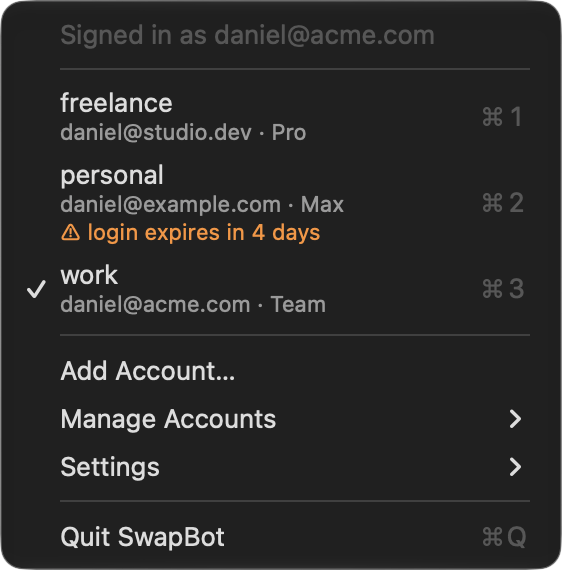

<div align="center">
  
</div>

# SwapBot
Switch Claude Code between Claude accounts from the macOS menu bar.

SwapBot keeps several Claude logins (say, work and personal) side by side, all sharing one `~/.claude` config, and swaps between them with one click. Only the login changes. Your settings, MCP servers and history stay put.

## Install

Download SwapBot from the [latest release](https://github.com/Daniel-Griffiths/swapbot/releases/latest) and follow the install steps there. It runs on macOS 15 or later, on Apple silicon and Intel.

Turn on **Settings → Launch at Login** in SwapBot's menu to start it automatically.

### Build from source

Requires the Swift toolchain (Xcode or the Command Line Tools).

```sh
./scripts/build-app.sh --install   # build, copy to ~/Applications and launch
./scripts/build-app.sh --dmg       # build a universal build/SwapBot.dmg
```

## Usage

Click the robot in the menu bar:



- **Switch:** click an account, or press its number while the menu is open. The account you're leaving is saved again first, so tokens Claude Code refreshed while it was in use aren't lost.
- **Usage:** just before switching away from an account, SwapBot runs `claude -p "/usage"` to read its session and weekly usage. It also picks up the usage Claude Code caches in `~/.claude.json` whenever it fetches it. Hover over an account to see its usage, along with when each limit resets. Accounts you haven't switched away from yet have no usage.
- **Auto-Switch:** Settings → Auto-Switch… switches account by itself when one hits its session or weekly limit. Accounts are arranged in fallback groups, one per organization to start with. When an account runs out, SwapBot switches to the member of its group that has used the least. When every member is used up, it moves on to the group you chose as that group's next one. Drag accounts between groups, or out of every group so they never switch. Switching happens without asking and without quitting sessions.
- **Add Account…** opens Terminal running `claude auth login`. Sign in there and SwapBot asks what to call the new account. You don't need to log out of the current account first. It's saved before the new login replaces it.
- **Save Current Login…** appears when you're signed in to an account that isn't saved yet, for example after running `/login` in Claude Code.
- **Manage Accounts:** Log In Again (for an expiring login), Rename, Remove.
- **Settings:** Launch at Login, whether the account name appears next to the icon, and Stay Awake with Lid Closed. That last one runs `pmset -a disablesleep` and asks for your administrator password. The Mac then doesn't sleep at all, even after SwapBot quits, until you turn it off.

The icon shows a `?` badge when the current login isn't saved and an `×` badge when Claude Code is signed out.

> [!NOTE]
> Switching, adding an account or logging in again asks first if Claude Code sessions are running: quit them, continue anyway, or cancel. A session left running carries on under the new account and resends its whole conversation without the old account's cache, which gets expensive for long conversations. Quit sessions' conversations are saved, so `claude --resume` picks them up again. Switching between two accounts in the same team skips this, because a team's accounts share one prompt cache.

## How it works

A Claude Code login on macOS is two things: the `claudeAiOauth` object in the Keychain item `Claude Code-credentials`, and the `oauthAccount`/`userID` fields in `~/.claude.json`. For each saved account, SwapBot stores:

- a Keychain item `Claude Code-credentials:<name>` holding only `{"claudeAiOauth": …}`
- `~/.claude/account-profiles/<name>.meta.json` holding the account metadata

Switching replaces only `claudeAiOauth` on the live item, so MCP server tokens (`mcpOAuth`) aren't touched. The account in use is worked out by matching `~/.claude.json` against the saved metadata. Empty tokens are never saved over a good copy, and an empty copy is never restored.

Auto-Switch adds a global `StopFailure` hook to `~/.claude/settings.json` that runs `SwapBot --limit-reached` when a turn stops on a rate limit. It only acts on usage limits ("You've hit your session limit · resets 3:20pm"), not on temporary 429s. It marks that window as full on the account until it resets, then switches. Hook runs within a minute of a switch are ignored, so several sessions hitting the same limit switch only once. Each decision is logged to `~/.claude/account-profiles/auto-switch.log`. Turning Auto-Switch off removes the hook and leaves your other hooks alone.

The Keychain is accessed through `/usr/bin/security` rather than Security.framework. That tool is already on the items' access list, so there are no Keychain prompts, and Claude Code can read everything SwapBot writes.

## Command line

```sh
~/Applications/SwapBot.app/Contents/MacOS/SwapBot --list                          # saved accounts and their last recorded usage
~/Applications/SwapBot.app/Contents/MacOS/SwapBot --switch <name>                 # switch to a saved account
~/Applications/SwapBot.app/Contents/MacOS/SwapBot --switch <name> --quit-sessions # quit running Claude Code sessions first
```

`--switch` works like clicking an account: it records the outgoing account's usage, then swaps the login. It refuses while Claude Code sessions are running unless you pass `--quit-sessions`, except when both accounts are in the same team.

## Development

```sh
swift test   # uses a throwaway Keychain service, never your live login
```

The binary has a few read-only debugging modes:

```sh
~/Applications/SwapBot.app/Contents/MacOS/SwapBot --dump        # accounts and token expiry
~/Applications/SwapBot.app/Contents/MacOS/SwapBot --dump-menu   # the menu as text
```

Set `SWAPBOT_SERVICE`, `SWAPBOT_PROFILE_DIR` and `SWAPBOT_CLAUDE_JSON` to point the app at test data. To regenerate the icon after changing `RobotIcon.swift`:

```sh
.build/debug/SwapBot --render-app-icon /tmp/AppIcon.iconset
iconutil -c icns /tmp/AppIcon.iconset -o Resources/AppIcon.icns
cp /tmp/AppIcon.iconset/icon_256x256@2x.png assets/icon.png
```
